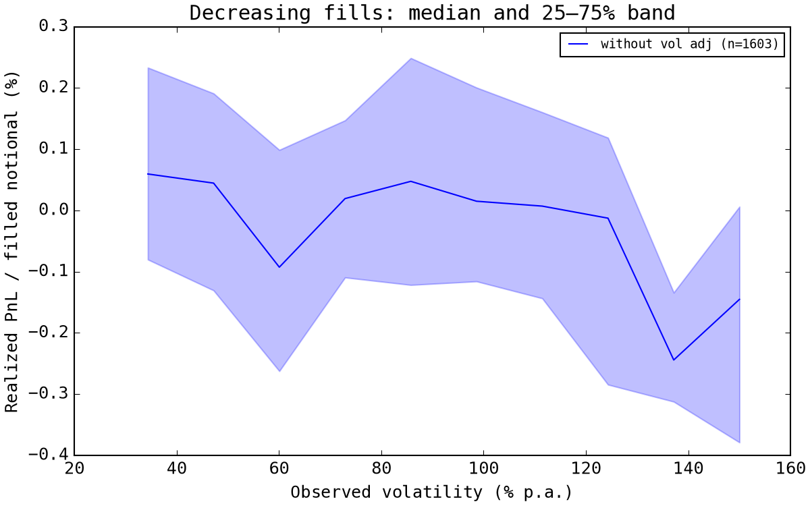
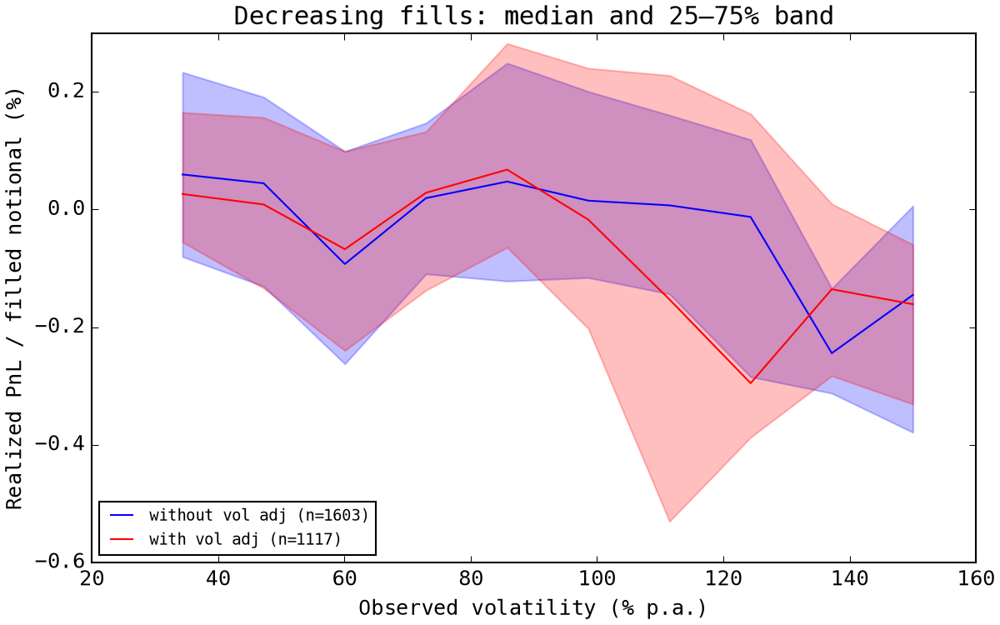
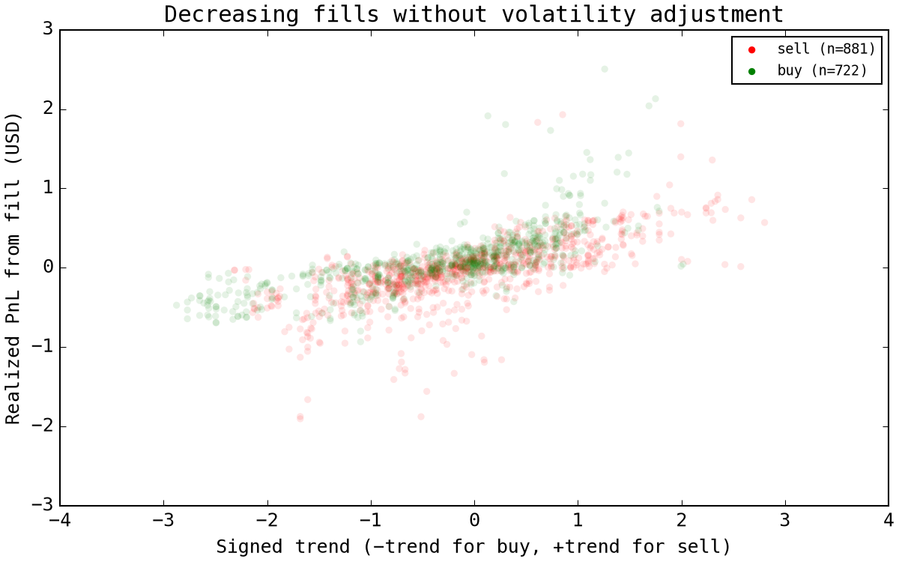
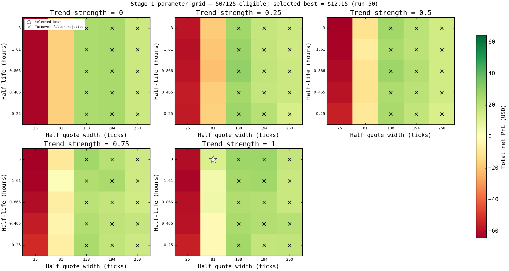
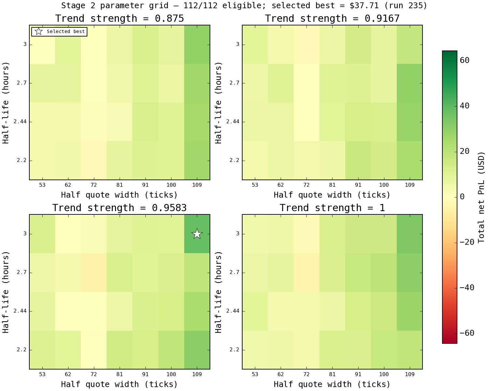
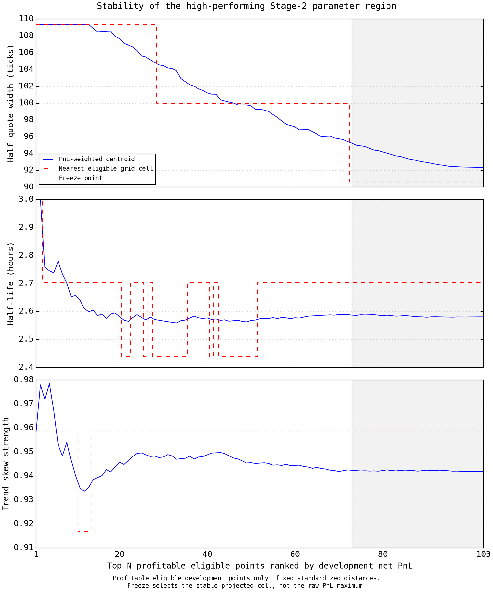

# Executive Summary

This project develops and evaluates a passive market-making strategy for the ETH perpetual market using a causal event-driven backtester with explicit placement and cancellation latency, queue-aware partial fills, maker fees, funding, and hard inventory constraints.

The objective is not to construct a highly parameterized predictive trading model. Instead, the experiment asks whether a compact and economically interpretable market-making policy can remain coherent once execution frictions and inventory risk are modeled explicitly.

The strategy is built around the idea that inventory should be treated as a temporary working state rather than as a persistent directional position. Passive fills naturally create short-lived long or short exposure, but the strategy maintains no directional inventory target. Its long-run target is always zero. Directional information is used only to manage inventory that has already been acquired through passive execution.

The development process begins with a simple fixed-width market maker quoting symmetrically around the current midpoint. This baseline is used to study the interaction between quote width, participation, fees, local realized volatility, and closing-order quality before introducing additional control rules.

Two empirical effects motivate the final design.

First, inventory-reducing fills become less attractive in higher local realized-volatility regimes. A simple linear volatility adjustment of quote width is tested as a natural normalization, but it does not clearly stabilize closing-order outcomes. The final strategy therefore does not impose this scaling rule. Instead, quote width remains fixed and realized volatility is treated as an external execution-risk factor whose effect can be observed directly.

Second, realized PnL on inventory-reducing fills is strongly associated with the contemporaneous local trend state. Closing long inventory while the market is falling, or short inventory while the market is rising, is systematically less favorable than reducing exposure into a supportive local move. This relationship is not interpreted as stand-alone predictive alpha; rather, it motivates a bounded control rule for the timing and aggressiveness of inventory reduction.

The resulting strategy separates inventory management into two channels. Inventory magnitude controls order-size asymmetry: as the position approaches its hard limit, quoting size is progressively shifted away from the inventory-increasing side and toward the inventory-reducing side. A causal volatility-normalized trend signal then adjusts the quote center, making inventory reduction more aggressive when the local directional state is favorable and less aggressive when it is unfavorable. The trend signal has no effect when inventory is zero and therefore cannot independently create a directional position.

Strategy development and parameter search are performed on March 19. March 20 is used as an in-sample holdout that does not feed back into parameter selection, and March 21 is reserved for final OOS evaluation. Parameter selection uses a coarse-to-fine grid search followed by a stability-based selection procedure intended to identify a broad high-performing region rather than a single pointwise PnL maximum.

The final frozen strategy is then replayed continuously across all three days, with inventory and signal state carried across daily boundaries. The continuous run produces a net PnL of **-$4.53** on a $10,000 initial allocation, with **$44.2k of turnover**, **920 fills**, and a maximum drawdown of **$55.36 (0.55%)**. Maximum sampled marked inventory exposure reaches **19.45% of equity** against the 20% hard inventory limit.

The final OOS regime is particularly informative. A sharp late-session market move is accompanied by an abrupt increase in local realized volatility, exposing the residual risk that remains even under active inventory control: a passive market maker cannot neutralize inventory instantaneously. The resulting loss is therefore interpreted as an economically consistent failure mode of the frozen strategy rather than as a reason to retune the model after the fact.

The main conclusion is not that positive expected return has been established or that the strategy is production-ready. The available sample is far too short for such a claim. Rather, the experiment shows that a low-dimensional market-making policy can produce coherent execution and inventory dynamics under realistic latency, queue constraints, partial fills, transaction costs, funding, and a hard risk budget.

The principal remaining research questions are whether the observed execution relationships persist over a longer sample, how quote width should adapt to forecastable volatility rather than backward-looking realized volatility, how strategy economics degrade with increasing order size, and whether additional short-horizon microstructure signals can improve adverse-selection control and inventory unwind timing.

# Table of Contents

- [Executive Summary](#executive-summary)
- [Passive Market Making under Realistic Execution Constraints](#passive-market-making-under-realistic-execution-constraints)
  - [Introduction](#introduction)
  - [Key Findings](#key-findings)
- [Data and Experimental Setup](#data-and-experimental-setup)
  - [Data](#data)
  - [Temporal Split](#temporal-split)
- [Backtesting Framework](#backtesting-framework)
  - [Event-Driven Simulation](#event-driven-simulation)
  - [Order Placement, Cancellation, and Latency](#order-placement-cancellation-and-latency)
  - [Inventory Risk Reservation](#inventory-risk-reservation)
  - [Fill Model](#fill-model)
    - [Trade-Through](#trade-through)
  - [Fees and Funding](#fees-and-funding)
  - [Portfolio Accounting](#portfolio-accounting)
- [Strategy Design and Research](#strategy-design-and-research)
  - [Baseline Quoting Policy](#baseline-quoting-policy)
  - [Quote Width, Participation, and the Fee Hurdle](#quote-width-participation-and-the-fee-hurdle)
- [Volatility as an External Risk Factor](#volatility-as-an-external-risk-factor)
  - [Fixed Width versus Volatility Scaling](#fixed-width-versus-volatility-scaling)
  - [Realized Volatility and Closing-Order Quality](#realized-volatility-and-closing-order-quality)
  - [Linear Volatility Adjustment as a Robustness Check](#linear-volatility-adjustment-as-a-robustness-check)
- [Closing Economics and Local Trend](#closing-economics-and-local-trend)
  - [Closing PnL](#closing-pnl)
  - [Local Trend Signal](#local-trend-signal)
- [Inventory Management](#inventory-management)
  - [Inventory as a Temporary State](#inventory-as-a-temporary-state)
  - [Hard Inventory Budget](#hard-inventory-budget)
  - [Size-Based Inventory Control](#size-based-inventory-control)
- [Trend-Aware Quote Skew](#trend-aware-quote-skew)
  - [Long Inventory](#long-inventory)
  - [Short Inventory](#short-inventory)
- [Final Strategy](#final-strategy)
- [Parameter Selection](#parameter-selection)
  - [Two-Stage Grid Search](#two-stage-grid-search)
  - [Stable-Region Selection](#stable-region-selection)
- [In-Sample Holdout](#in-sample-holdout)
- [Out-of-Sample Evaluation](#out-of-sample-evaluation)
- [Discussion](#discussion)
  - [What the Strategy Is — and Is Not](#what-the-strategy-is--and-is-not)
  - [Inventory Management as the Central Control Problem](#inventory-management-as-the-central-control-problem)
  - [Volatility as Risk Rather than a Fitted Control Rule](#volatility-as-risk-rather-than-a-fitted-control-rule)
  - [Interpretation of the Trend Relationship](#interpretation-of-the-trend-relationship)
- [Limitations](#limitations)
  - [Limited Historical Sample](#limited-historical-sample)
  - [Realized Volatility Is Not a Volatility Forecast](#realized-volatility-is-not-a-volatility-forecast)
  - [Queue Position Is Approximate](#queue-position-is-approximate)
  - [Small-Agent Assumption](#small-agent-assumption)
  - [No Systematic Capacity Sweep](#no-systematic-capacity-sweep)
  - [Single Instrument and Venue](#single-instrument-and-venue)
  - [No External Hedge](#no-external-hedge)
  - [Limited Statistical Independence](#limited-statistical-independence)
  - [Strategy Search Is Necessarily Adaptive](#strategy-search-is-necessarily-adaptive)
- [Further Development](#further-development)
  - [Data-Driven Volatility Adjustment](#data-driven-volatility-adjustment)
  - [Capacity Analysis](#capacity-analysis)
  - [Additional Signals](#additional-signals)
  - [External Hedging](#external-hedging)
  - [Longer Historical Evaluation](#longer-historical-evaluation)
- [Conclusion](#conclusion)

# Passive Market Making under Realistic Execution Constraints

## Introduction

This work studies a passive market-making strategy for the ETH perpetual market under realistic execution assumptions.

The objective is deliberately narrow. Rather than constructing a highly parameterized predictive model, the goal is to determine whether a compact market-making policy can remain economically viable once order latency, queue position, partial fills, transaction fees, funding, and inventory risk are accounted for explicitly.

A central design consideration is the role of inventory.

Passive market making necessarily creates temporary directional exposure: one side of the quote may be filled without an immediate offsetting trade. This does not by itself make the strategy directional. The distinction is whether inventory remains a transient working state of the liquidity-provision process or becomes a persistent source of return.

The strategy therefore has no directional target position. Its long-run inventory target is zero, and directional information is never used to decide whether the strategy should become structurally long or short. Instead, directional state is used only conditionally, to control how aggressively inventory already acquired through passive fills should be reduced.

This motivates a useful behavioral diagnostic. In a well-behaved market-making regime, unrealized PnL should remain bounded and predominantly temporary, while successful inventory cycles are repeatedly converted into realized PnL through subsequent fills. Persistent accumulation of unrealized PnL would instead indicate that returns increasingly depend on a directional position in the underlying asset.

The research process proceeds from a deliberately simple baseline.

First, a causal event-driven simulator is constructed from historical order-book snapshots, trades, and funding data. A basic market maker then quotes symmetrically at a fixed distance from the current midpoint. This allows the execution economics of the strategy to be observed without embedding additional predictive assumptions into the quoting rule.

The development analysis reveals two economically relevant effects.

First, closing-order quality deteriorates in higher local realized-volatility regimes. A simple linear volatility adjustment is tested as a natural response, but does not materially stabilize the conditional execution statistics. The final strategy therefore keeps its nominal quote width fixed and treats realized volatility as an external market risk factor rather than an input to an imposed spread-scaling rule.

Second, the profitability of inventory-reducing fills is strongly related to the contemporaneous local trend state. This motivates a state-dependent unwind rule: inventory magnitude determines the willingness to acquire additional risk through asymmetric order sizes, while the local trend controls the price aggressiveness of inventory reduction.

The resulting strategy remains structurally market-making: inventory is created by passive fills, the target inventory is always zero, and the directional signal only modifies the management of already-existing exposure.

The available data consist of three consecutive calendar days. March 19 is used for strategy development and parameter search, March 20 is retained as an in-sample holdout used to evaluate stability without feeding results back into parameter selection, and March 21 is reserved as the final untouched out-of-sample evaluation.

## Key Findings

The main findings of the experiment are:

- realistic execution assumptions materially constrain the available market-making edge, particularly under a 2 bp maker fee;
- higher local realized volatility is associated with weaker closing-order economics under fixed-width passive quoting;
- a simple linear volatility-based spread adjustment does not clearly remove this dependence;
- closing-order profitability is strongly associated with the local directional state;
- separating inventory control into order-size asymmetry and trend-dependent price skew produces economically interpretable inventory dynamics;
- the selected parameter region transfers qualitatively from the development sample to the in-sample holdout without feeding holdout results back into parameter selection;
- in the continuous frozen-parameter replay, the complete three-day result is approximately flat after costs at **-$4.53**, while the final OOS regime exposes the principal residual risk of the strategy: inventory cannot be neutralized instantaneously during a sharp directional move.

The final OOS behavior is particularly informative because it exposes a genuine failure mode of the frozen strategy rather than being removed through subsequent retuning.

# Data and Experimental Setup

## Data

The dataset covers the ETH perpetual market from March 19 to March 21, 2026.

Three event streams are provided:

- 20-level order-book snapshots containing bid and ask prices and quantities;
- executed trades containing timestamp, price, size, and aggressor side;
- funding-rate observations sampled approximately every 20 seconds.

All timestamps are provided at nanosecond resolution.

The market is represented as a single instrument, so no symbol-level routing, cross-asset hedging, or cross-venue execution is required.

The order book provides the observable market state used for quote placement, queue initialization, and mark-to-market valuation. The trade stream is used both for historical execution simulation and for causal market-state signals.

The funding stream is treated separately from trade execution. High-frequency funding observations are not interpreted as continuous cash transfers; only settlement events contribute to portfolio funding PnL.

## Temporal Split

The three days are treated chronologically:

- **March 19**: development
- **March 20**: in-sample holdout
- **March 21**: final OOS

March 19 is intentionally exploratory. Strategy structure, diagnostics, and parameter ranges are developed while observing this sample directly.

Parameter selection is performed entirely on this development sample.

March 20 is subsequently inspected to determine whether the selected strategy behaves similarly under a different market realization. It is not used to modify the parameter-search region or retune the strategy.

After this check, the strategy specification, execution assumptions, and parameters are frozen.

March 21 is then evaluated as the final out-of-sample period. Its result is accepted without further parameter adjustment.

This split is intentionally conservative given the small amount of available data. No attempt is made to interpret millions of individual market events as millions of statistically independent observations.

# Backtesting Framework

## Event-Driven Simulation

The backtester processes all market events in chronological order.

At each timestamp, the strategy has access only to information that has already appeared in the historical event stream. No future order-book state, trades, funding observations, or derived features are visible when a decision is made.

The simulation state contains

$$
\text{market state} + \text{open orders} + \text{cash} + \text{inventory} + \text{PnL}.
$$

Order-book snapshots update the visible liquidity state.

Trades may consume simulated queue volume and generate partial or full executions against resting strategy orders.

Funding settlements produce the corresponding portfolio cashflow.

Strategy actions are generated from the current observable state and enter the runtime subject to explicit placement and cancellation latency.

This causal event ordering is preserved throughout both strategy logic and performance evaluation.

## Order Placement, Cancellation, and Latency

The strategy operates exclusively with passive limit orders.

At each requoting step, the current strategy state determines desired bid and ask prices and quantities. Existing orders that no longer match the desired target are cancelled and replaced.

The nominal requoting interval is fixed at 500 ms. Market events continue to be processed normally between strategy decisions.

Both placement and cancellation are subject to 50 ms latency.

A newly submitted order therefore does not become active immediately. Similarly, an order awaiting cancellation remains executable until the cancellation command completes.

This produces an important stale-quote exposure: market conditions may change between decision time and order activation or cancellation.

At activation, passivity is checked again against the latest available BBO.

A buy must satisfy

$$
p^{\text{bid}} < a_t,
$$

and a sell must satisfy

$$
p^{\text{ask}} > b_t.
$$

If the quote has become marketable during the placement delay, it is rejected rather than converted into a taker order. No maker execution or maker fee is simulated in this case.

At equal timestamps, historical market events are processed before delayed command completions.

Latency is treated as part of the execution environment rather than as a strategy parameter.

## Inventory Risk Reservation

The strategy operates under a hard marked-equity inventory limit.

The runtime additionally reserves capacity for live same-side orders, including pending placements and pending cancellations.

Let

$$
Q_{\max} = 0.2\frac{E_t}{m_t}
$$

denote the current inventory budget.

Available buy and sell capacity are approximately

```text
buy_capacity
    = max(0, Q_max - position - live_buy_quantity)

sell_capacity
    = max(0, Q_max + position - live_sell_quantity)
```

New quantities are capped by the corresponding remaining capacity and rounded down to the exchange quantity step.

Capacity is not released merely because cancellation has been requested: the order continues to reserve risk until the cancellation actually completes.

This prevents multiple in-flight orders from independently assuming that the same inventory capacity remains available.

The budget itself is evaluated using current equity and mark price. Subsequent market moves, fees, or funding may therefore reduce the effective limit, while already existing positions are not forcibly liquidated.

## Fill Model

Historical execution is simulated from the observable L2 order book together with aggressive trade prints.

When a passive order becomes active, the visible quantity already resting at its exact same-side price level in the latest observed snapshot initializes its queue-ahead estimate.

An inside-spread order placed at an otherwise empty price level therefore starts with

$$
Q_{\mathrm{ahead}}=0.
$$

If a price level already contains visible liquidity, the strategy joins behind that displayed quantity.

Subsequent aggressive trades at the same price consume queue ahead before reaching the simulated order.

For example, if

$$
Q_{\mathrm{ahead}}=10
$$

and a seller-aggressor trade of size 4 occurs at the price of a resting buy,

$$
Q_{\mathrm{ahead}} \rightarrow 6,
$$

and the strategy receives no fill.

If instead

$$
Q_{\mathrm{ahead}}=3
$$

and the same-price aggressive trade has size 5, the first 3 units consume the queue ahead and up to 2 units may execute against the strategy order.

Partial fills are supported.

The simulator deliberately follows a conservative queue-position approximation.

Displayed depth reductions in later snapshots do not move the strategy forward in the queue. Such reductions may result from cancellations rather than executions, and cannot be identified reliably from periodic L2 snapshots.

Likewise, newly observed liquidity at the same price is assumed to have joined behind the strategy and therefore does not increase queue ahead.

Queue advancement is driven only by relevant observed aggressive trade flow.

### Trade-Through

A strict trade-through is treated as stronger evidence that the order's price level has been consumed.

For a resting buy,

$$
p_{\mathrm{trade}} < p_{\mathrm{order}}
$$

is considered trade-through.

For a resting sell,

$$
p_{\mathrm{trade}} > p_{\mathrm{order}}.
$$

In this case the external queue ahead is cleared and the order becomes eligible for execution.

Every own fill remains bounded by both the historical trade-volume budget and the remaining order quantity.

When several own orders are eligible, executions are allocated first by best price and then by activation time.

An order cannot fill before its activation timestamp, and order-book snapshots alone never create fills.

The simulator does not attempt to reproduce the exact exchange matching engine. Exact queue reconstruction is impossible from periodic L2 snapshots without message-by-order data.

The objective is instead to maintain a causal and intentionally conservative approximation that does not systematically generate optimistic passive fills.

The strategy is additionally assumed to be a small participant: its own orders do not modify historical prices, visible market depth, or future trade flow.

This assumption becomes important when discussing capacity later.

## Fees and Funding

Transaction costs are included explicitly.

A maker fee of

$$
f_{\mathrm{maker}} = 0.0002 = 0.02\%
$$

is applied to every passive fill, corresponding to 2 basis points of traded notional.

For a fill at price $p_i$ and absolute quantity $|\Delta q_i|$,

$$
\mathrm{fee}_i = f_{\mathrm{maker}} p_i|\Delta q_i|.
$$

No fee rebate or token-based fee discount is assumed.

This is a relatively demanding execution regime for passive market making: a complete two-sided inventory cycle pays the maker fee on both legs before accounting for adverse selection or funding.

Funding is accounted for separately.

For position $q_t$, reference price $p_t$, and settlement funding rate $r_t$,

$$
\mathrm{FundingPnL}_t = -q_tp_tr_t.
$$

The sign convention is such that positive funding represents payment from longs to shorts.

## Portfolio Accounting

The strategy state is represented by cash $C_t$, inventory $q_t$, and reference market price $m_t$.

Mark-to-market equity is

$$
E_t=C_t+q_tm_t.
$$

A buy of signed quantity $\Delta q>0$ at price $p$ updates the state as

$$
q_{t^+} = q_{t^-}+\Delta q,
$$

$$
C_{t^+} = C_{t^-} - p\Delta q - \mathrm{fee}.
$$

A sell is represented by negative signed quantity and follows the same accounting convention.

For interpretation, trading PnL is additionally decomposed into realized and unrealized components.

The average entry price of the currently open inventory is maintained explicitly.

When a fill reduces a long position,

$$
\mathrm{PnL}^{\mathrm{realized}}_i = \left( p_i-\bar p_{\mathrm{entry}} \right) Q_i^{\mathrm{closed}}.
$$

For a short position,

$$
\mathrm{PnL}^{\mathrm{realized}}_i = \left( \bar p_{\mathrm{entry}}-p_i \right) Q_i^{\mathrm{closed}}.
$$

The remaining position is marked relative to the same average entry price to obtain unrealized PnL.

The resulting accounting identity is

$$
\mathrm{PnL}_t = \mathrm{PnL}^{\mathrm{realized}}_t + \mathrm{PnL}^{\mathrm{unrealized}}_t + \mathrm{PnL}^{\mathrm{funding}}_t - \mathrm{fees}_t.
$$

The realized/unrealized split is not used as an optimization target by itself.

Instead, it serves as a behavioral sanity check.

A market maker necessarily carries temporary inventory between executions. Inventory PnL is therefore not intrinsically undesirable. The undesirable regime is one in which accumulated strategy performance increasingly depends on a persistent directional mark-to-market position.

The desired qualitative behavior is instead

$$
\text{temporary inventory} \rightarrow \text{temporary unrealized PnL} \rightarrow \text{inventory reduction} \rightarrow \text{realized PnL}.
$$

The strategy is therefore designed to repeatedly close inventory cycles rather than maintain a directional forecast through time.

# Strategy Design and Research

## Baseline Quoting Policy

The initial strategy is intentionally simple.

At each decision point, the current best bid and ask define the midpoint

$$
m_t = \frac{b_t+a_t}{2}.
$$

The strategy posts one passive order on each side at a fixed nominal half-width $h$:

$$
p_t^{\text{bid}} = m_t-h,
$$

$$
p_t^{\text{ask}} = m_t+h.
$$

Prices are rounded to the exchange tick size before submission.

The midpoint is used as the market reference rather than a slower directional fair-value estimate.

This is deliberate. A persistent shift of the quote center based on a directional fair-value model can easily transform an apparent market-making strategy into a directional trading strategy carrying inventory as a consequence of the forecast.

The baseline therefore asks a simpler question:

> What execution and inventory behavior emerges from passive quoting itself?

This configuration is evaluated on the development sample across a range of quote widths.

## Quote Width, Participation, and the Fee Hurdle

Quote width creates an immediate trade-off:

- narrow quotes interact with the market more frequently and therefore produce more fills and turnover;
- at the same time, they are more exposed to adverse selection and must overcome the maker fee on a larger amount of traded notional;
- wider quotes improve the economics of individual executions but progressively reduce participation.

<!-- Figure: quote width vs fill count / traded notional -->

<!-- Figure: quote width / traded notional vs execution quality -->

The development sweep exhibits the expected participation-execution frontier.

As quote width increases, gross execution quality improves while fill count and turnover fall sharply.

Under the assumed 2 bp maker fee, very aggressive fixed-width quoting does not generate sufficient execution edge to justify its turnover. Positive execution economics appear only at considerably wider quotes, where participation has already declined substantially.

This motivates searching for a strategy that improves inventory management without relying simply on extremely wide passive quotes.

The width parameter is nevertheless retained as one of the primary strategy parameters.

# Volatility as an External Risk Factor

## Fixed Width versus Volatility Scaling

A fixed-width quote does not represent the same economic risk in every market regime.

As local short-horizon volatility increases, a resting quote is more likely to be reached. At the same time, the probability that the quote becomes stale or is executed immediately before an unfavorable move may also increase.

A standard response is therefore to scale quote width with a causal realized-volatility estimate.

A simple implementation is

$$
h_t = h_0 \frac{\sigma_t} {\sigma_{\mathrm{ref}}},
$$

where $\sigma_t$ is the currently observed local annualized realized volatility and $\sigma_{\mathrm{ref}}$ is a reference volatility level at which the nominal half-width equals $h_0$.

For example, $\sigma_{\mathrm{ref}}$ may be interpreted as the market-volatility regime under which a nominal width of 100 ticks is intended.

This type of normalization is appealing because it attempts to make quote placement statistically comparable across changing market conditions.

However, it also introduces a significant additional assumption:

> recently observed realized volatility must provide the correct scale for future execution risk, and that risk must map to quote width through the chosen functional form.

The choice of volatility estimator, lookback horizon, reference level, and scaling function therefore becomes part of the trading model.

Rather than imposing this relationship from the start, the development analysis first keeps quote width fixed and observes how execution outcomes change with the external volatility regime.

## Realized Volatility and Closing-Order Quality

For each inventory-reducing fill, define its realized closing return as

$$
r_i^{\text{close}} = \frac{ \mathrm{PnL}_i^{\text{realized}} }{ p_i Q_i^{\text{closed}} }.
$$

The local realized volatility observed immediately before the fill is recorded alongside this return.

The observations are then grouped by volatility regime.

Within each volatility bucket, the median and interquartile range of closing returns are estimated.



*Closing-order returns across observed realized-volatility regimes under fixed-width quoting. The median and interquartile range deteriorate in the higher-volatility part of the development sample, suggesting an external execution-risk effect.*

The development sample exhibits a visible deterioration in closing-order quality in the high-volatility part of the observed range.

The effect is not limited to isolated negative outliers. Both the median and the upper part of the conditional return distribution shift downward.

This behavior is economically consistent with a short-volatility-like property of fixed-width passive quoting.

Higher volatility increases quote interaction but can simultaneously increase stale-quote and adverse-selection risk.

The available sample is too small to identify a precise structural volatility threshold, and the high-volatility tail contains fewer observations. The relationship is therefore interpreted qualitatively rather than as a precisely estimated functional law.

Nevertheless, the observed regime dependence is sufficiently clear to motivate an explicit robustness test.

## Linear Volatility Adjustment as a Robustness Check

The same analysis is repeated using the simple linear volatility-adjusted width

$$
h_t = h_0 \frac{\sigma_t} {\sigma_{\mathrm{ref}}}.
$$



*Fixed-width versus linear volatility-adjusted quoting. Linear width adjustment does not clearly stabilize conditional closing returns, motivating fixed nominal width and treating realized volatility as an external market-state risk factor.*

If this transformation correctly normalized the dominant execution risk, the conditional closing-return distribution would be expected to become substantially more stable across volatility regimes.

This does not occur clearly in the development sample. The volatility-adjusted specification remains regime-dependent, and the dispersion of closing outcomes is not consistently reduced.

The result should not be interpreted as evidence that volatility adjustment is generally undesirable.

Rather, it indicates that the particular linear rule above should not be treated as a neutral normalization of market conditions. It is itself a model of how historical volatility maps into optimal quote geometry.

For the final strategy, the nominal quote width is therefore kept fixed.

Observed local realized volatility remains an external market-state variable and an explicit source of risk rather than being partially neutralized by construction.

A more systematic volatility-adaptive policy is left for further work, where the mapping from volatility to quote width could be estimated from a larger sample using fill probability, adverse selection, markouts, and inventory outcomes.

# Closing Economics and Local Trend

## Closing PnL

The next question is not whether inventory can be eliminated entirely—it cannot—but whether the strategy can control when and how that inventory is reduced.

Closing fills provide a natural object for this analysis.

For every trade that reduces the absolute inventory,

$$
|q_{t^+}|<|q_{t^-}|,
$$

the realized PnL of the closed quantity is measured relative to its average entry price.

A profitable long unwind therefore requires the closing sell price to exceed the average price at which the corresponding inventory was acquired.

Likewise, a profitable short unwind requires the closing buy price to lie below the average entry price of the short inventory.

This makes closing-order PnL directly interpretable as the quality of an inventory-reduction event.

## Local Trend Signal

The directional state is represented by a causal exponentially weighted drift-to-volatility ratio constructed from executed trade prices.

For consecutive distinct trade timestamps, define

$$
r_i = \log\frac{p_i}{p_{i-1}},
$$

$$
\Delta t_i=t_i-t_{i-1}.
$$

Let $H$ denote the signal half-life in seconds and

$$
d_i=2^{-\Delta t_i/H}
$$

the corresponding exponential decay factor.

Three state variables are updated recursively:

$$
L_i=d_iL_{i-1}+r_i,
$$

$$
Q_i=d_iQ_{i-1}+r_i^2,
$$

$$
D_i=d_iD_{i-1}+\Delta t_i.
$$

The local log-price drift over one half-life is estimated as

$$
\widehat{\Delta\log p}_H = \frac{L_i}{D_i}H,
$$

while the realized volatility over the same horizon is estimated as

$$
\widehat{\sigma}_H = \sqrt{ \frac{Q_i}{D_i}H }.
$$

The normalized trend signal is therefore

$$
z_i = \frac{ \widehat{\Delta\log p}_H }{ \widehat{\sigma}_H } = \frac{ (L_i/D_i)H }{ \sqrt{(Q_i/D_i)H} }.
$$

The signal is dimensionless and can be interpreted as the recent directional price move measured in units of local realized volatility. Positive values correspond to an upward local trend and negative values to a downward local trend.

Because both the numerator and denominator are computed only from trades observed up to the current timestamp, the signal is causal.

For diagnostic purposes, the signal is oriented relative to the inventory being closed:

$$
z_t^{\text{unwind}} = \mathrm{sign}(q_{t^-})z_t.
$$

Under this convention,

$$
z_t^{\text{unwind}}>0
$$

corresponds to a market move favorable for reducing the current inventory:

- long inventory with positive price trend;
- short inventory with negative price trend.

Conversely,

$$
z_t^{\text{unwind}}<0
$$

represents an unfavorable local move for inventory reduction.



*Realized closing PnL versus signed local trend for inventory-reducing fills. Buy closes use negative raw trend and sell closes use raw trend, so positive values indicate a favorable unwind state. Their similar positive relationship motivates bounded trend modulation of unwind aggressiveness rather than a directional inventory target.*

The development sample exhibits a strong relationship between this signed trend state and closing-order profitability.

Intuitively, selling a long inventory position while the market is already moving downward tends to crystallize an unfavorable inventory cycle. Selling the same inventory into a locally rising market produces systematically better closing outcomes.

The corresponding statement holds symmetrically for short inventory.

The relationship should not be interpreted as a stand-alone proof of predictive alpha.

Closing PnL and contemporaneous trend both depend on the current price state, so part of the observed association is mechanical. The diagnostic is instead used to motivate a control rule and is subsequently judged by the performance of the complete causal strategy on holdout and OOS data.

The important observation is therefore qualitative:

> the desirability of reducing inventory depends on the current directional state.

This creates a natural role for the trend signal without turning the strategy into a directional position-taking model.

# Inventory Management

## Inventory as a Temporary State

The long-run inventory target remains

$$
q^*=0.
$$

The trend signal never changes this target.

Instead, inventory management is separated into two control channels:

1. **order-size asymmetry** controls the willingness to acquire additional inventory;
2. **price skew** controls how aggressively existing inventory is reduced under the current trend state.

This separation is useful because inventory magnitude and market direction answer different questions.

Inventory answers:

> How much additional risk should the strategy be willing to accept?

The trend signal answers:

> How attractive is the current market state for reducing that risk?

## Hard Inventory Budget

Let

$$
q_{\max,t} = \lambda\frac{E_t}{m_t},
$$

with

$$
\lambda=0.20.
$$

Define normalized inventory

$$
x_t = \mathrm{clip} \left( \frac{q_t}{q_{\max,t}}, -1, 1 \right).
$$

The hard inventory budget is a safety constraint, not a desired position.

## Size-Based Inventory Control

Let the neutral order quantity be

$$
Q_{0,t} = \eta \frac{E_t}{m_t},
$$

where $\eta$ is a fixed order-size fraction, equal to 1% of equity in the experiments below.

Before exchange rounding and runtime risk caps, desired bid and ask quantities are

$$
Q_t^{\text{bid}} = Q_{0,t}(1-x_t),
$$

$$
Q_t^{\text{ask}} = Q_{0,t}(1+x_t).
$$

When inventory is flat,

$$
x_t=0,
$$

and therefore

$$
Q_t^{\text{bid}} = Q_t^{\text{ask}} = Q_{0,t}.
$$

For positive inventory,

$$
x_t>0,
$$

the strategy progressively transfers quoting size from the inventory-increasing bid to the inventory-reducing ask.

At the long inventory limit,

$$
x_t=1,
$$

so the unconstrained target quantities become

$$
Q_t^{\text{bid}}=0,
$$

$$
Q_t^{\text{ask}}=2Q_{0,t}.
$$

The short side is symmetric.

At

$$
x_t=-1,
$$

the strategy no longer attempts to increase the short position and instead allocates the available quoting size toward buying inventory back.

Before risk caps,

$$
Q_t^{\text{bid}} + Q_t^{\text{ask}} = 2Q_{0,t},
$$

so inventory management redistributes the existing quoting budget rather than simply increasing total desired liquidity as risk grows.

Actual submitted quantities are subsequently capped by the runtime's live-order inventory reservation.

This mechanism makes inventory correction continuous and directly interpretable.

It also prevents the price controller from carrying the full burden of risk management.

# Trend-Aware Quote Skew

Inventory size controls how much additional risk the strategy is willing to acquire, while the local trend determines how aggressively the strategy attempts to reduce existing exposure.

Let

- $m_t$ be the current best-bid/best-ask midpoint;
- $h>0$ be the fixed nominal quote half-width in price units, equivalently the configured half-width in ticks multiplied by the tick size;
- $q_t$ be the current base-asset inventory;
- $q_{\max,t}$ be the current hard inventory limit;
- $x_t$ be normalized inventory,

$$
x_t = \mathrm{clip} \left( \frac{q_t}{q_{\max,t}}, -1,1 \right);
$$

- $z_t$ be the causal signed local trend signal, where $z_t>0$ denotes an upward local trend and $z_t<0$ a downward local trend;
- $\beta\ge0$ be the dimensionless trend-skew strength.

The raw trend signal is bounded using

$$
g(z_t)=\tanh(z_t),
$$

so that extreme signal values cannot generate arbitrarily large quote displacements.

The resulting price skew is

$$
s_t = \beta h|x_t|\tanh(z_t).
$$

Here, $s_t$ has the same units as price. Its magnitude grows with both the current inventory utilization $|x_t|$ and the strength of the local trend, while its sign is determined by the direction of the trend.

The adjusted quote center is

$$
c_t=m_t-s_t,
$$

and the final target quotes are

$$
p_t^{\text{bid}}=c_t-h,
$$

$$
p_t^{\text{ask}}=c_t+h.
$$

The inventory sign does not enter the skew formula explicitly. Instead, it determines which side of the market is inventory-reducing: a downward center shift favors selling long inventory, while an upward center shift favors buying back short inventory.

This control rule has several useful properties.

First,

$$
q_t=0 \quad\Rightarrow\quad x_t=0 \quad\Rightarrow\quad s_t=0.
$$

The trend signal therefore has no effect when the strategy has no inventory.

It cannot independently create a directional position.

Second, the skew grows with the magnitude of existing inventory.

A small position receives only a small price adjustment, while a position closer to the risk budget receives a stronger state-dependent correction.

Third, the hyperbolic tangent bounds the effect of extreme signal values.

The directional behavior is intuitive.

### Long Inventory

If

$$
q_t>0
$$

and the local trend is positive,

$$
z_t>0,
$$

then

$$
s_t>0,
$$

$$
c_t<m_t.
$$

Both quotes move downward.

The ask becomes more competitive, increasing the probability of reducing the long inventory, while the bid moves farther from the market.

If the market is instead falling,

$$
z_t<0,
$$

the quote center moves upward.

The strategy remains inventory-constrained through its order-size asymmetry, but becomes less aggressive about crystallizing the long position into an unfavorable local move.

### Short Inventory

For short inventory,

$$
q_t<0,
$$

a negative market trend is favorable for buying the position back.

When

$$
z_t<0,
$$

the quote center shifts upward, the bid becomes more competitive and the ask less aggressive.

The mechanism is therefore symmetric without explicitly changing the sign of the trend signal in the pricing formula.

# Final Strategy

The final policy can be summarized as follows.

At each strategy update:

1. compute the current BBO midpoint;
2. compute the causal local trend signal;
3. determine current marked-equity inventory capacity;
4. normalize the current inventory;
5. redistribute bid and ask order quantities according to normalized inventory;
6. compute a bounded trend-dependent quote-center skew proportional to absolute inventory;
7. place quotes at a fixed nominal half-width around the adjusted center;
8. apply exchange rounding, live-order risk reservation, passivity checks, latency, and queue-aware historical execution.

The strategy therefore has only a small number of economically interpretable behavioral parameters.

The final search focuses on

$$
\theta=(h,\tau,\beta),
$$

where

- $h$ is the nominal quote half-width;
- $\tau$ is the trend-signal half-life;
- $\beta$ is the trend-skew strength.

The hard inventory fraction, execution latency, fee assumptions, and order-management rules are treated as environment or risk constraints rather than freely optimized parameters.

# Parameter Selection

## Two-Stage Grid Search

Parameter selection is performed only on the March 19 development sample.

A hierarchical grid search is used instead of a high-dimensional optimizer.

The first stage is deliberately coarse and covers a broad region of

$$
(h,\tau,\beta)
$$

space.

Its purpose is not precise optimization.

It is used to locate economically viable regions of the parameter domain.

Once a promising region is identified, a second denser grid is evaluated locally.

This produces a higher-resolution view of the objective surface around the candidate region.

Configurations with traded notional below the initial capital allocation are excluded from parameter selection. This minimum-turnover filter is independent of PnL and is intended to remove configurations with insufficient market participation to provide a meaningful estimate of the strategy's execution economics.



*Stage 1 coarse parameter search on the development sample. Colors show net PnL on a common scale; configurations rejected by the minimum-turnover criterion are marked separately. This stage identifies a viable parameter region.*



*Stage 2 refined parameter search around the promising Stage-1 region. The marked raw PnL maximum is shown only as a reference; final selection uses the stable high-performing region rather than pointwise maximization.*

The primary ranking statistic is net PnL after fees and funding, subject to basic behavioral and risk sanity checks such as inventory utilization, drawdown, fill count, and the realized/unrealized PnL profile.

The final point is not selected purely as the single highest-PnL grid node.

Such a rule would make the procedure unnecessarily sensitive to noise in a very short development sample.

## Stable-Region Selection

The refined grid is therefore analyzed geometrically.

Only profitable configurations that pass the Stage-2 eligibility filter enter the centroid analysis.

For each cutoff $k$, the top-$k$ configurations ranked by development-sample net PnL are selected. Using net PnL as a positive weight, their parameter-space centroid is

$$
\bar{\theta}_k = \frac{ \sum_{i\in\mathrm{Top}(k)} \mathrm{PnL}_i\,\theta_i }{ \sum_{i\in\mathrm{Top}(k)} \mathrm{PnL}_i }.
$$

Because the three parameters have different units and numerical ranges, distances are evaluated in standardized parameter coordinates. The normalization is computed once from the eligible Stage-2 grid.

For every $k$, the weighted centroid is projected back to the nearest actually tested eligible Stage-2 configuration using Euclidean distance in this standardized space.



*Stability of the high-performing Stage-2 parameter region. Blue shows the PnL-weighted centroid of top-N profitable eligible configurations; red dashed lines show the nearest tested grid cell in standardized parameter space. The final configuration is frozen from the stable projected region.*

For very small $k$, the centroid is naturally unstable because it is dominated by a small number of individual configurations.

As progressively more high-performing points are included, the centroid stabilizes.

The freeze point is defined by the terminal region in which the projected nearest Stage-2 grid cell remains unchanged as additional profitable configurations are included. The final strategy therefore uses a parameter combination that was actually backtested rather than the continuous centroid itself.

This stabilization is interpreted as evidence for a broad high-performing basin rather than an isolated point optimum.

The procedure is therefore

$$
\text{broad coarse search} \rightarrow \text{local refinement} \rightarrow \text{stable high-performing region} \rightarrow \text{frozen tested configuration}.
$$

The intention is robustness rather than numerical maximization of one development day.

# In-Sample Holdout

After parameter selection is complete, the chosen configuration is evaluated unchanged on March 20.

No information from March 20 is fed back into the parameter search.

For diagnostic purposes, the development and holdout days are also evaluated separately from a fresh initial state. These isolated daily runs are useful for comparing behavior across calendar days, but they are not the primary portfolio-level performance result because inventory and signal state are reset at the daily boundary.

The selected strategy produces qualitatively similar behavior on the holdout day:

- inventory remains actively managed rather than accumulating monotonically;
- both long and short inventory states occur;
- realized PnL continues to accumulate through inventory-reducing fills;
- the strategy remains profitable after transaction fees.

The isolated daily results are:

| Diagnostic sample | Date | Net PnL | Fills |
|---|---|---:|---:|
| Development | 2026-03-19 | $29.2163 | 77 |
| In-sample holdout | 2026-03-20 | $20.8847 | 59 |

The purpose of the holdout is not to establish statistical significance from a single additional day.

It is simply to verify that the mechanism identified on the development sample does not immediately disappear under a different market realization.

Because the holdout result is not fed back into parameter selection, the strategy is then frozen for the final OOS evaluation.

# Out-of-Sample Evaluation

After the strategy and parameters are frozen, March 21 is exposed as the final OOS market segment.

No subsequent parameter adjustment is performed.

As a standalone diagnostic run from a fresh state, March 21 produces:

| Diagnostic sample | Date | Net PnL | Fills |
|---|---|---:|---:|
| Final OOS | 2026-03-21 | -$16.2825 | 65 |

The primary portfolio-level evaluation, however, is the continuous frozen-parameter replay across March 19–21.

Inventory, average entry price, signal state, and outstanding strategy state are carried across the daily boundaries rather than reset.


*Continuous frozen-parameter backtest across March 19 (development), March 20 (in-sample holdout), and March 21 (OOS), distinguished by background shading. Vertically aligned panels show positions, equity, realized/unrealized PnL, fees and funding, price and average entry, order placements and quantities, quote width and skew, trend, and realized volatility. Inventory and signal state carry across the daily boundaries.*

The continuous run ends at the last available book observation on March 21 at 23:59:56 UTC.

| Metric | Full-run result |
|---|---:|
| Total net PnL | -$4.5340 |
| Final equity | $9,995.4660 |
| Total turnover | $44,200.6629 |
| Turnover / initial equity | 4.4201× |
| Total fills, including partial executions | 920 |
| Maximum equity drawdown | $55.3601 (0.5515%) |
| Maximum absolute inventory | 0.930 ETH |
| Maximum absolute marked inventory / equity, sampled | 19.4496% |
| Trading fees paid | $8.8401 |
| Funding PnL | +$0.3773 |

PnL, turnover, fills, drawdown, fees, and funding come from the [saved full-event metrics](figures/frozen_backtest/run_001/metrics.json). Maximum base inventory uses every execution in the [fill audit](figures/frozen_backtest/run_001/fills.csv). The exposure ratio uses the [one-second accounting history](figures/frozen_backtest/run_001/history.csv), so it may omit within-second extrema.

The run ends with **0.904 ETH** of residual inventory marked at the final known price and is not forcibly liquidated.

The full three-day result is therefore approximately flat after costs rather than materially profitable.

The most important failure mode appears during the final OOS regime, where a sharp directional move occurs while the strategy is carrying non-zero inventory. This is economically consistent with the design: the market maker reduces persistent directional exposure but cannot eliminate the short-horizon risk created between passive fills.

Importantly, the OOS period still generates substantial trading activity and does not indicate an obvious mechanical failure of the execution or inventory-management logic.

The observed maximum marked inventory exposure remains just below the 20% hard risk limit.

Because only three daily observations are available, annualized return and daily Sharpe estimates are not treated as meaningful performance statistics.

The analysis therefore emphasizes directly observed quantities:

- realized and unrealized PnL dynamics;
- fills and turnover;
- inventory exposure;
- drawdown;
- fees and funding;
- execution behavior under changing market regimes.

# Discussion

## What the Strategy Is — and Is Not

The final strategy uses directional information, but it is not a directional strategy in the usual sense.

The key distinction is that the trend signal never determines a desired long or short inventory.

The target inventory remains

$$
q^*=0.
$$

A nonzero trend signal has no pricing effect when inventory is zero.

Directional state only influences the aggressiveness with which inventory that already exists is reduced.

Inventory itself is generated by passive market-making fills rather than by an explicit directional entry decision.

This distinction is reflected in the desired PnL dynamics.

The strategy should not depend on accumulating a persistent unrealized gain from holding ETH in one direction.

Instead, inventory is expected to behave as a temporary state repeatedly converted into realized trading PnL.

The realized/unrealized decomposition is therefore primarily a structural sanity check rather than an optimization target.

## Inventory Management as the Central Control Problem

The experiments suggest that inventory management is the central problem of the tested market-making setup.

A purely symmetric strategy has no mechanism preventing one-sided fills from accumulating directional exposure.

A pure price-skew controller can reduce inventory, but strong risk correction requires moving both quotes substantially away from their neutral geometry.

The final strategy separates these responsibilities.

Inventory magnitude controls size:

$$
|q_t| \rightarrow \text{order-size asymmetry}.
$$

The local market state controls timing:

$$
z_t \rightarrow \text{quote-price skew}.
$$

This makes the policy both interpretable and relatively low-dimensional.

The strategy becomes progressively unwilling to increase an existing position as it approaches the inventory limit, while the trend signal determines whether the current market environment is relatively favorable or unfavorable for reducing that position.

The approximately flat full-sample result is consistent with this interpretation: the strategy demonstrates coherent inventory control, but the current signal and execution policy do not yet establish a robust positive edge after costs.

## Volatility as Risk Rather than a Fitted Control Rule

The volatility analysis illustrates a broader modeling choice.

It is tempting to normalize every observable source of regime dependence directly inside the strategy.

Doing so can make backtest statistics look more stationary, but each normalization embeds an additional hypothesis about how the market variable should map into an optimal trading action.

The development sample suggests that realized volatility materially affects closing-order quality.

However, the simplest linear spread adjustment does not clearly remove this effect.

For this reason, the final strategy does not attempt to eliminate volatility dependence mechanically.

Instead, realized volatility remains an explicitly observable external risk factor.

This preserves the empirical relationship for analysis and avoids introducing an additional heuristic controller whose functional form is weakly identified by only three days of data.

## Interpretation of the Trend Relationship

The closing-PnL/trend relationship is useful but should also be interpreted carefully.

Both the trend variable and realized closing PnL depend on the contemporaneous price state.

The observed scatter relationship is therefore not independent evidence that the signal predicts future returns.

Its role in this work is different.

It identifies an economically plausible state variable for inventory management:

> favorable directional states tend to coincide with better inventory-reduction outcomes.

The strategy then converts this observation into a bounded causal control rule and evaluates the resulting complete system on a holdout day and a final OOS day.

This distinction avoids treating an attractive in-sample scatter plot as standalone predictive evidence.

# Limitations

The experiment has several important limitations.

### Limited Historical Sample

Only three calendar days are available.

This is sufficient to study simulator behavior, strategy mechanics, and short-horizon parameter stability, but not to estimate long-run expected return, Sharpe ratio, tail risk, or regime robustness with high confidence.

The final OOS sample consists of only one day.

### Realized Volatility Is Not a Volatility Forecast

The volatility variable used in the analysis is backward-looking.

It measures the recent local market regime but does not imply that future volatility is known.

A production volatility-adjusted strategy would require a separate analysis of forecastability, estimator horizon, lag, and the economic value of the forecast.

### Queue Position Is Approximate

The simulator has L2 snapshots and trade prints rather than message-by-order exchange data.

Exact queue identities, hidden liquidity, and cancellations ahead of the simulated order cannot be reconstructed.

The queue model is intentionally conservative, but it remains an approximation.

### Small-Agent Assumption

The strategy's own orders do not modify historical prices, future order-book depth, or subsequent trade flow.

This is reasonable for small order sizes but prevents the current backtest from identifying true strategy capacity once endogenous market impact becomes relevant.

### No Systematic Capacity Sweep

Partial fills, queue depletion, and finite historical trade volume already make execution sensitive to submitted quantity.

However, order size is not systematically scaled in the present experiment, and the strategy remains under the small-agent assumption.

The current results therefore do not establish an economic capacity limit.

### Single Instrument and Venue

The strategy is tested on one perpetual market.

No cross-venue information, spot-perpetual basis, correlated instruments, or external hedging market is used.

### No External Hedge

All inventory risk is managed by the same passive quoting process that created the inventory.

A production market maker could instead hedge part of its inventory externally, materially changing both risk and execution economics.

### Limited Statistical Independence

Individual fills are strongly dependent through time.

They share the same market regime, inventory state, and nearby price path.

Consequently, fill-level sample size should not be interpreted as the number of independent statistical observations.

The volatility-bucket and trend analyses are therefore primarily descriptive.

### Strategy Search Is Necessarily Adaptive

The first day is explicitly exploratory and is used to develop both the strategy structure and parameter ranges.

It should therefore not be interpreted as an unbiased performance sample.

The separation between the development day, the holdout day that does not feed back into parameter selection, and the final OOS day is used to limit this bias, but cannot replace a substantially larger historical dataset.

# Further Development

## Data-Driven Volatility Adjustment

The current experiment deliberately avoids imposing a linear volatility controller.

A natural next step is to estimate the relationship

$$
\sigma_t \rightarrow \{ P(\mathrm{fill}), \text{markout}, \text{closing quality}, \text{inventory risk} \}
$$

on a much larger dataset.

The resulting empirical relationship could then be used to design a nonlinear volatility-dependent quote-width policy.

This would turn volatility adjustment from an ex-ante heuristic into a control rule grounded in observed execution economics.

Stress extrapolation beyond the observed volatility range could also be explored, although such extrapolation would necessarily rely on additional structural assumptions.

## Capacity Analysis

The current simulator already captures one important source of finite execution capacity: strategy orders may be only partially filled, and own executions are bounded by the observed historical trade volume available at the relevant price.

As order size increases, the strategy therefore cannot automatically assume a proportional increase in executed quantity. Larger orders may remain partially unfilled, persist for longer, or consume a larger fraction of the available historical aggressive flow.

This provides a natural starting point for a first-order capacity study.

A simple experiment would scale the neutral order quantity as

$$
Q_0\rightarrow cQ_0,
$$

for example

$$
c\in\{0.5,1,2,4,\ldots\},
$$

while keeping the quoting and inventory-control policy fixed.

For each scale factor, the relevant diagnostics would include:

- requested versus actually filled quantity;
- fraction of orders receiving partial fills;
- fill rate as a function of order size;
- traded notional and turnover;
- PnL per unit of traded notional;
- order size relative to displayed depth;
- queue-ahead consumption;
- inventory holding time;
- maximum inventory and drawdown.

An economically meaningful capacity limit would appear when increasing submitted size no longer produces approximately proportional growth in executed volume or PnL, while inventory risk and unfilled resting quantity continue to increase.

The present simulator can capture part of this effect because execution is limited by observed queue depletion and historical trade volume.

However, this remains a historical small-agent capacity estimate rather than a full market-impact model.

The strategy's own orders do not alter future market depth, trade flow, queue behavior, or prices. At sufficiently large scale, those assumptions would become invalid.

A more complete capacity analysis would therefore require either an endogenous impact model or live execution data.

Nevertheless, the existing partial-fill and queue-aware simulator is sufficient to perform a useful first-pass study of how strategy economics degrade as order size approaches the locally available liquidity.

## Additional Signals

The final strategy intentionally uses a minimal signal set.

This leaves substantial room for improvement.

Potential short-horizon signals include:

- BBO imbalance and microprice displacement;
- multi-level order-book imbalance;
- recent aggressive trade-flow imbalance;
- short-horizon post-fill markout predictors;
- quote-age and queue-state information;
- cross-venue price discrepancies;
- spot/perpetual basis;
- correlated-instrument moves;
- funding-state information.

The important separation should remain the same:

> a signal should first demonstrate stable economic information, and only then be incorporated into a quoting or inventory-control rule.

In particular, directional signals need not imply directional target inventory.

They may instead be used to improve adverse-selection control, quote placement, or unwind timing.

## External Hedging

A natural extension is to separate liquidity provision from inventory neutralization.

The strategy could continue quoting passively on the primary venue while using a correlated or cross-venue instrument to hedge inventory that exceeds a threshold.

This would change the economics substantially by introducing hedge fees, basis risk, hedge latency, and potentially taker costs, but could reduce the largest directional inventory drawdowns observed in the current experiment.

## Longer Historical Evaluation

The most valuable next experiment is simply more data.

A longer sample would allow:

- genuine train/validation/OOS segmentation;
- volatility-regime analysis across multiple market states;
- block-bootstrap uncertainty estimates;
- more meaningful drawdown and Sharpe statistics;
- robust parameter-surface comparison;
- evaluation of rare directional shocks;
- testing whether the observed trend-conditioned unwind effect persists over time.

# Conclusion

The experiment begins with a deliberately simple passive market maker and asks whether economically sensible behavior can survive realistic execution constraints.

The resulting strategy remains compact.

It does not attempt to predict a persistent directional fair value. Instead:

- the midpoint anchors quote geometry;
- a fixed width determines baseline participation;
- inventory magnitude reallocates order size away from further risk accumulation;
- a bounded local trend signal modifies the price aggressiveness of inventory reduction;
- a hard inventory budget limits exposure;
- realistic latency, fees, queue position, and funding are included explicitly.

The development analysis identifies both the strengths and weaknesses of this setup.

Passive execution becomes less attractive in high-volatility regimes, and a simple linear volatility-adjustment rule does not clearly neutralize the effect.

Inventory-reducing fills are strongly related to local trend state, providing a natural state variable for unwind control.

A coarse-to-fine parameter search identifies a stable high-performing region on the development sample rather than relying on a single point optimum. The selected configuration remains profitable on the in-sample holdout day without using that result for retuning.

The final continuous frozen-parameter replay finishes approximately flat after costs, with net PnL of **-$4.53** on a $10,000 initial allocation.

This result does not establish a profitable production strategy.

It does, however, provide a useful boundary between what appears to work structurally and what remains unresolved.

The inventory-control mechanism behaves coherently, the strategy remains within its hard risk budget, and the parameter-selection procedure identifies a broad rather than isolated development optimum.

At the same time, the final OOS regime shows that short-horizon inventory risk during abrupt directional moves can offset the edge accumulated under more favorable conditions.

The experiment should therefore be interpreted as a viable research direction rather than a finished strategy.

The most important next steps are broader signal research, a data-driven volatility controller, systematic capacity testing, external hedging, and evaluation over a substantially larger and more diverse historical sample.